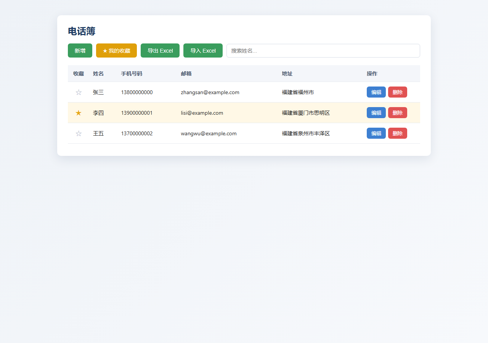
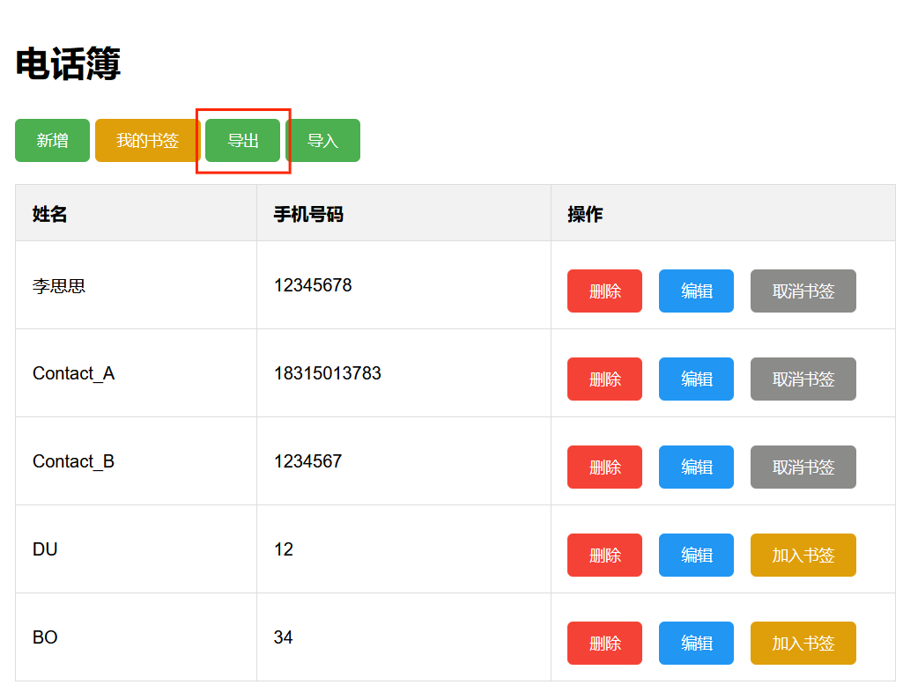
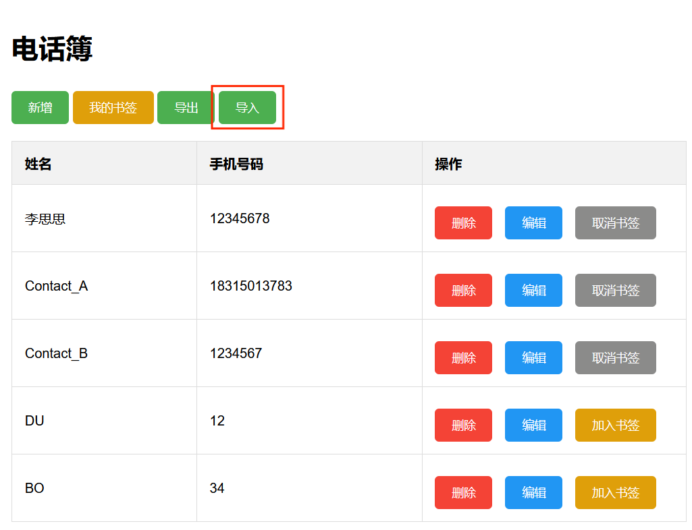
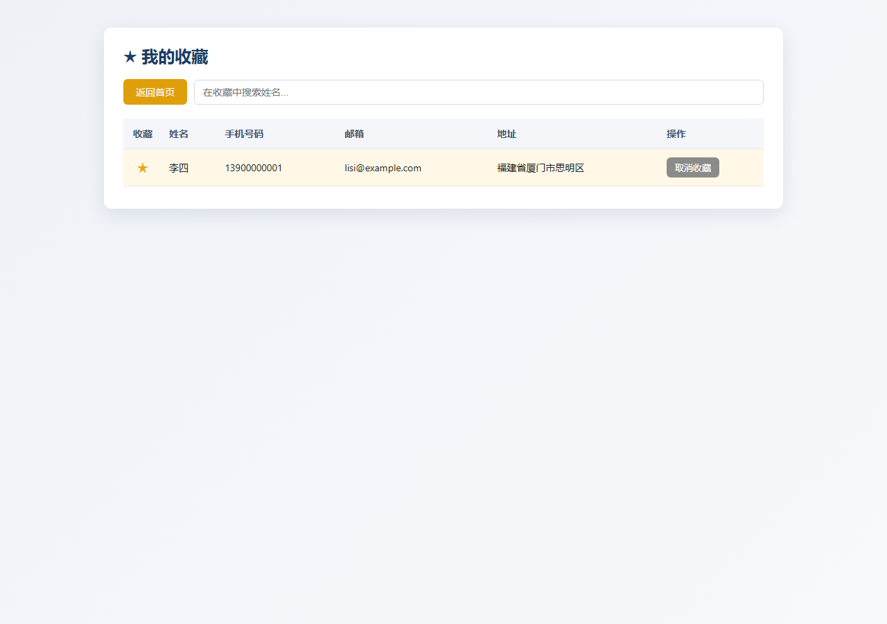

| Item | Content |
| --- | --- |
| Course for This Assignment | EE308FZ Software Engineering (FZU–MU) |
| Team Name | 832401112-832401219 |
| Assignment Requirements | 实现通讯录的收藏联系人、多联系方式与 Excel 导入导出；作业链接：【待填写：作业要求链接】 |
| Objectives of This Assignment | Experience the full Extreme Programming development process: module division, Git collaboration, iterative development, testing and delivery of an address book with bookmark, multiple contact methods and Excel import/export |
| Other References | [Google Java Style Guide](https://google.github.io/styleguide/javaguide.html) · [EasyExcel](https://github.com/alibaba/easyexcel) · [Spring Boot Docs](https://docs.spring.io/spring-boot/docs/2.3.12.RELEASE/reference/html/) · [MyBatis-Plus](https://baomidou.com/) |

[TOC]

# Extreme Programming — Address Book

This blog records the design, implementation and delivery of the address book
assignment. The project is a front-end / back-end separated web application that
supports **bookmarking contacts**, **multiple contact methods** and
**Excel import / export**.

## 1. Project address

- GitHub repository: <https://github.com/JorgeHUANG7/extreme-programming-832401112-832401219>
- Code style guide: [docs/code-style.md](https://github.com/JorgeHUANG7/extreme-programming-832401112-832401219/blob/main/docs/code-style.md)
- Deployment guide: [docs/deploy.md](https://github.com/JorgeHUANG7/extreme-programming-832401112-832401219/blob/main/docs/deploy.md)
- Front-end entry: `frontend/index.html`
- Back-end service: `http://<server-ip>:8888`
- Cloud application (public URL): 【待填写：部署后的公网地址，例如 http://1.2.3.4:8080/index.html】

## 2. GitHub submission log

| Contributor | GitHub account | Commits |
| --- | --- | --- |
| 黄志远 | `JorgeHUANG7` | 7 |
| 王少杰 | `060725` | 4 |

> 提交记录截图放在 `docs/images/` 下，建议命名 `commits-<account>.png`。

【待填写：成员1提交记录截图，文件名 `commits-member1.png`】

【待填写：成员2提交记录截图，文件名 `commits-member2.png`】

## 3. Module division and architecture

Before coding we split the system into four modules so that both members could
work in parallel without blocking each other:

| Module | Responsibility | Main files |
| --- | --- | --- |
| Front end | Pages, interactions, request encapsulation, Excel upload/download | `frontend/*.html`, `frontend/js/*`, `frontend/css/*` |
| Back end | REST API, validation, bookmark logic, Excel parsing/export | `backend/src/main/java/.../controller`, `service`, `utils` |
| Database | Schema, defaults, sample data | `database/schema.sql` |
| Delivery | Docker Compose, deployment, documentation, blog | `docker-compose.yml`, `docs/*` |

Architecture:

```
Browser (HTML/CSS/JS) --HTTP/JSON--> Spring Boot (Controller/Service/Mapper)
                                              |
                                        MySQL 8 (user table)
```

- The front end is pure static files, so it can be opened directly or served by Nginx.
- The back end exposes RESTful APIs and uses MyBatis-Plus for CRUD.
- EasyExcel handles both import and export with the same `User` entity, so the
  exported file can be imported back without editing headers.

## 4. Description of functional implementation ideas

### 4.1 Bookmark contacts


- **Database:** a `collect` column (`INT NOT NULL DEFAULT 1`). `1` = not bookmarked, `2` = bookmarked.
- **Back end:** `PUT /toggleBookmark` updates the status; `GET /collectList` returns only bookmarked contacts.
- **Front end:**
  - every row has a ★ / ☆ button; clicking it toggles the status and reloads the list;
  - bookmarked rows are highlighted in yellow (`tr.collected`), so they are visible at a glance;
  - `collect.html` lists only bookmarked contacts and supports searching inside the collection.



### 4.2 Multiple contact methods


- **Database:** `phone` (mobile), `phone1` (home phone), `email`, `socialmedia`,
  `address`, `image` (avatar URL).
- **Front end:** the add/edit modal contains one input per contact method, plus an
  avatar picker with instant preview.
- **Back end:** all fields are returned by `/list`; `POST /uploadImage` stores the
  avatar in Aliyun OSS and returns its URL (optional feature).
- **List view:** name, mobile, email and address are shown directly in the table,
  so different contact methods are visible without opening the edit dialog.


### 4.3 Search and page style

- The toolbar has a search box; input is debounced by 300 ms and calls
  `GET /list?name=...`, so filtering happens on the server and stays correct for
  large data sets.
- The collection page filters the already-loaded collection locally, which keeps
  switching fast.
- The layout uses a card container, a unified toolbar, hover feedback and a
  responsive rule for narrow screens (`@media (max-width: 640px)`).

### 4.4 Import and export

**Export**



- The front end calls `GET /export`, receives a blob and triggers a download named
  `my_contacts.xlsx`.
- The back end uses `ExcelExportUtil` (EasyExcel) to write **one row per contact**
  and **one column per field**: `用户名 | 手机号码 | 家庭电话 | 邮箱地址 | 社交媒体 | 真实地址`.

**Import**



- The front end opens a file picker and posts the file as `multipart/form-data` to
  `POST /importExcel`.
- The back end reads rows with EasyExcel and `UserListener`, then inserts them in
  batches of 100.
- Validation rules:
  - rows whose `用户名` or `手机号码` is blank are **skipped** instead of failing the
    whole import;
  - `collect` defaults to `1` for imported contacts;
  - the API returns `ok:<imported>:<skipped>` and the front end shows
    “导入完成：成功 N 条，跳过 M 条”;
  - parse errors return `error:<reason>` and the front end shows a readable message.
- Because the export and import share the same entity annotations, a file exported
  by the system can be imported back directly.

### 4.5 Deployment

- `docker-compose.yml` starts three containers: MySQL 8, the Spring Boot back end
  and an Nginx container serving `frontend/`.
- `backend/Dockerfile` builds with JDK 11 (Spring Boot 2.3.x does not build on
  JDK 17+) and runs on a JRE 11 image.
- `frontend/js/config.js` automatically points `API_BASE` to
  `http://<current-host>:8888` when the page is not opened from `localhost`, so the
  same build works locally and on a cloud server.
- Deployment steps are documented in `docs/deploy.md` (security group, Docker
  installation, startup, verification and update).

## 5. Program screenshots and running video

> 截图和视频需在真实运行的应用上录制，建议分辨率 1280×720 以上。

### 5.1 Bookmark contacts




【待填写：收藏 / 取消收藏的操作 GIF，文件名建议 `bookmark.gif`】

### 5.2 Multiple contact methods

【待填写：新增/编辑多条联系方式的截图，建议 `multi-contact.png`】

### 5.3 Excel export and import

【待填写：导出文件内容截图 + 导入成功提示截图，建议 `excel-export.png`、`excel-import.png`】

### 5.4 Complete running video

【待填写：完整演示视频链接（Bilibili / 阿里云盘 / GitHub Release 附件）】

Video script suggestion:

1. Start the application and open the contact list;
2. Add a contact with mobile, home phone, email, social media and address;
3. Bookmark it and show the yellow highlight and the collection page;
4. Search by name;
5. Export to Excel and open the downloaded file;
6. Modify a row, import it back, show the “成功 N 条” message;
7. Show the database table (`SELECT * FROM user;`) to prove persistence.

## 6. Division of labor among team members

| Name | Student ID | Work |
| --- | --- | --- |
| 黄志远 | 832401112 | Back-end architecture, database design, Excel export, Docker deployment, blog review |
| 王少杰 | 832401219 | Front-end pages and interactions, bookmark UI, search, Excel import validation, code style document, blog writing |

> 请按实际分工修改，确保与 Git 提交内容一致。

## 7. Contribution ratio

| Name | Contribution |
| --- | --- |
| 黄志远 | 50% |
| 王少杰 | 50% |

> 两人合计必须为 100%，并与提交记录、分工表保持一致。

## 8. Difficulties encountered and solutions

### 8.1 黄志远

- **Problem:** Excel import inserted the whole batch at once, so one row without a
  name or phone made the entire import fail with an unreadable error.
- **Solution:** added row-level validation in `UserListener`, batched writes every
  100 rows, and returned `ok:<imported>:<skipped>` / `error:<reason>` so the front
  end can show a meaningful result.
- **Problem:** MyBatis-Plus mapper XML path pointed to a non-existent package
  (`com.example.form`), which would silently skip mapper XML files.
- **Solution:** corrected `mapper-locations` to
  `classpath*:com/example/files/**/*Mapper.xml`.
- **Problem:** after importing `schema.sql` on Windows, Chinese characters in the
  database became `????`, because the MySQL client used the system code page
  instead of `utf8mb4`.
- **Solution:** import the schema with
  `mysql --default-character-set=utf8mb4 -u root -p < database/schema.sql`, and
  verified the returned JSON bytes are valid UTF-8.

### 8.2 王少杰

- **Problem:** the bookmark interaction was only a button label change, so
  bookmarked contacts were not visually obvious.
- **Solution:** replaced it with ★/☆ icons, added a `collected` row highlight and a
  dedicated collection page.
- **Problem:** when the page was opened from a cloud server, `API_BASE` still
  pointed to `localhost`, so every request failed.
- **Solution:** `config.js` now derives `API_BASE` from `location.hostname` and only
  falls back to `localhost:8888` for local development.

## 9. PSP tables

### PSP table of 黄志远

| Modules | Task Description | Estimated time (h) | Actual time (h) |
| --- | --- | --- | --- |
| Requirement analysis | Split modules and define the REST API | 3 | 4 |
| Preparation | Learn EasyExcel and MyBatis-Plus | 4 | 5 |
| Back-end development | CRUD, bookmark, import/export | 16 | 18 |
| Database development | Schema, defaults, sample data | 4 | 4 |
| Deployment | Docker Compose and cloud server | 5 | 6 |
| Testing and debugging | API tests and bug fixes | 7 | 8 |
| **Total** | | **39** | **45** |

### PSP table of 王少杰

| Modules | Task Description | Estimated time (h) | Actual time (h) |
| --- | --- | --- | --- |
| Requirement analysis | UI flow and interaction design | 3 | 3 |
| Preparation | Learn Fetch API and page layout | 4 | 4 |
| Front-end development | List, modal, bookmark, search | 16 | 18 |
| Integration | Connect front end to REST API | 5 | 6 |
| Documentation | Code style guide and blog | 4 | 5 |
| Testing and debugging | Browser compatibility and edge cases | 6 | 7 |
| **Total** | | **38** | **43** |

> Hours are taken from the team working log; adjust them if your own records differ.

