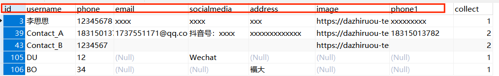
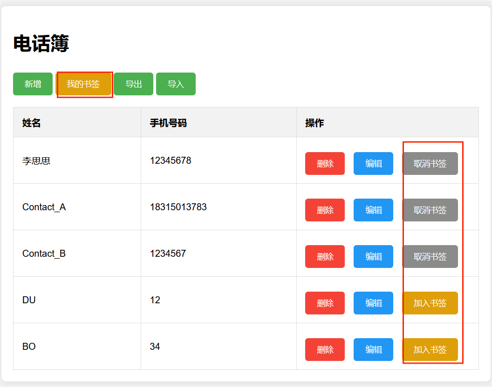

| Item | Content |
| --- | --- |
| Course for This Assignment | Software Engineering (FZU–MU) |
| Team Name | <!-- TODO: team name --> |
| Assignment Requirements | Implement bookmark contacts, multiple contact methods, and Excel import/export for an address book |
| Objectives of This Assignment | Experience the full Extreme Programming development process and strengthen front-end/back-end collaboration |
| Other References | [Google Java Style Guide](https://google.github.io/styleguide/javaguide.html) · [EasyExcel](https://github.com/alibaba/easyexcel) |

[TOC]

# Extreme Programming — Address Book

This blog records the design and implementation of the address book assignment.
The project is a front-end / back-end separated web application supporting
**bookmark contacts**, **multiple contact methods**, and **Excel import / export**.

## 1. Project address

- GitHub repository: https://github.com/JorgeHUANG7/-
- Front-end entry: `frontend/index.html`
- Back-end service: <!-- TODO: paste back-end access URL, or http://localhost:8888 -->
- Cloud deployment (optional): <!-- TODO: paste deployed URL, or write "not deployed" -->
- Code standard: [Google Java Style Guide](https://google.github.io/styleguide/javaguide.html)

## 2. GitHub submission log

> Replace the screenshots below with your own repository commit history and
> fill in the commit count per contributor.

| Contributor | Commits |
| --- | --- |
| <!-- TODO: name 1 --> | <!-- TODO: count --> |
| <!-- TODO: name 2 --> | <!-- TODO: count --> |

## 3. Description of functional implementation ideas

### 3.1 Design process

The system keeps the architecture of the earlier address-book assignment and
extends it.

- **Front end:** static HTML pages. CSS and JavaScript are split into separate
  files (`css/index.css`, `js/index.js`, `js/collect.js`). A new page
  (`collect.html`) displays bookmarked contacts.
- **Back end:** Spring Boot + MyBatis-Plus. The database is MySQL. New columns
  were added to support bookmarking and multiple contact methods.
- **Interaction:** RESTful API over HTTP.

### 3.2 Bookmark contacts

- **Database:** a `collect` column (`INT`). `1` = not bookmarked, `2` = bookmarked.
- **Front end:** each contact row has a bookmark button. Clicking it sends an HTTP
  request to change the status. `collect.html` lists only bookmarked contacts.
- **Back end:** `toggleBookmark` handles status changes and `collectList` returns
  bookmarked contacts.

### 3.3 Multiple contact methods

- **Database:** added `phone1` (home phone), `email`, `socialmedia`, `address`,
  and `image` (stored as a URL string).
- **Front end:** the add/edit modal contains input fields for every contact method,
  plus a "browse file" button for the avatar.

- **Back end:** contact methods are returned by the `list` interface; the avatar is
  uploaded through `uploadImage`.

### 3.4 Import and export

**Import**

- **Front end:** an "import" button opens a file picker and posts the file to the backend.
- **Back end:** `importExcel` reads the file with EasyExcel and `UserListener`
  persists the parsed rows into the database.

**Export**

- **Front end:** an "export" button triggers a file download.
- **Back end:** `export` uses `ExcelExportUtil` (EasyExcel) to write all contacts into
  an `.xlsx` file, where each contact is one row and each field is one column.

### 3.5 Main page

## 4. Program screenshots and running video

### 4.1 Bookmark contacts

<!-- TODO: insert GIF or screenshot of bookmarking + bookmark list -->

### 4.2 Multiple contact methods

<!-- TODO: insert GIF or screenshot of adding/editing multiple contact methods -->

### 4.3 Import and export

<!-- TODO: insert GIF or screenshot of export then import -->

### 4.4 Complete running video

<!-- TODO: insert a link to the complete running video (e.g. Bilibili / GitHub release asset / Google Drive) -->

## 5. Division of labor among team members

| Name | Student ID | Work |
| --- | --- | --- |
| <!-- TODO: name 1 --> | <!-- TODO: ID 1 --> | Back-end development, database design, blog writing |
| <!-- TODO: name 2 --> | <!-- TODO: ID 2 --> | Front-end development, front-end/back-end integration, blog integration |

## 6. Contribution ratio

| Name | Contribution |
| --- | --- |
| <!-- TODO: name 1 --> | <!-- TODO: e.g. 50% --> |
| <!-- TODO: name 2 --> | <!-- TODO: e.g. 50% --> |

## 7. Difficulties encountered and solutions

### 7.1 <!-- TODO: member name -->

- **Problem:** <!-- TODO -->
- **Solution:** <!-- TODO -->

### 7.2 <!-- TODO: member name -->

- **Problem:** <!-- TODO -->
- **Solution:** <!-- TODO -->

## 8. PSP table

### PSP table of <!-- TODO: name 1 -->

| Modules | Task Description | Estimated time (h) | Actual time (h) |
| --- | --- | --- | --- |
| Requirement analysis | Analyze requirements and outline project scope | <!-- TODO --> | <!-- TODO --> |
| Preparation | Learn related knowledge and prepare tools | <!-- TODO --> | <!-- TODO --> |
| Back-end development | Develop APIs and integrate with the database | <!-- TODO --> | <!-- TODO --> |
| Database development | Design schema and establish connections | <!-- TODO --> | <!-- TODO --> |
| Testing and debugging | Test the back end, fix bugs, optimize performance | <!-- TODO --> | <!-- TODO --> |
| **Total** | | <!-- TODO --> | <!-- TODO --> |

### PSP table of <!-- TODO: name 2 -->

| Modules | Task Description | Estimated time (h) | Actual time (h) |
| --- | --- | --- | --- |
| Requirement analysis | Analyze requirements and outline project scope | <!-- TODO --> | <!-- TODO --> |
| Preparation | Research and pre-design the front end | <!-- TODO --> | <!-- TODO --> |
| Front-end development | Design pages and send requests to the back end | <!-- TODO --> | <!-- TODO --> |
| Integration | Connect front end and back end | <!-- TODO --> | <!-- TODO --> |
| Testing and debugging | Test the front end, fix bugs, optimize performance | <!-- TODO --> | <!-- TODO --> |
| **Total** | | <!-- TODO --> | <!-- TODO --> |
