| Item | Content |
| --- | --- |
| Course for This Assignment | EE308FZ Software Engineering (FZU–MU) |
| Team Name | 832401112-832401219 |
| Assignment Requirements | [Extreme Programming（截止 2026-11-17 23:59）](https://bbs.csdn.net/topics/620593436)——实现通讯录的收藏联系人、多联系方式与 Excel 导入导出 |
| Objectives of This Assignment | 完整体验极限编程流程：模块划分、Git 协作、迭代开发、测试与交付，并掌握前后端分离应用的实现方法 |
| Other References | [Google Java Style Guide](https://google.github.io/styleguide/javaguide.html) · [EasyExcel](https://github.com/alibaba/easyexcel) · [Spring Boot 2.3.x Docs](https://docs.spring.io/spring-boot/docs/2.3.12.RELEASE/reference/html/) · [MyBatis-Plus](https://baomidou.com/) |

[TOC]

# Extreme Programming — 通讯录（Address Book）

本文记录了通讯录作业的设计、实现与交付过程。项目采用前后端分离架构，
支持**收藏联系人**、**单个联系人的多种联系方式**以及 **Excel 导入 / 导出**，
并在此基础上提供收藏星标、收藏行高亮、按姓名搜索与响应式页面样式。

## 1. 项目地址

- GitHub 仓库：<https://github.com/JorgeHUANG7/extreme-programming-832401112-832401219>
- 作业要求：<https://bbs.csdn.net/topics/620593436>
- 课程社区：`2601_FZU-MU_SE`
- 代码规范：[docs/code-style.md](https://github.com/JorgeHUANG7/extreme-programming-832401112-832401219/blob/main/docs/code-style.md)
- 部署指南：[docs/deploy.md](https://github.com/JorgeHUANG7/extreme-programming-832401112-832401219/blob/main/docs/deploy.md)
- 前端入口：`frontend/index.html`
- 后端服务：本地为 `http://localhost:8888`；使用 Docker / 云服务器部署时为 `http://<服务器IP>:8888`
- 云端部署：**本次未进行公网部署**（云端部署为可选附加项）。仓库已提供 `docker-compose.yml` 与部署文档，可在华为云 / 阿里云等服务器上一键复现。

## 2. GitHub 提交记录

| Contributor | GitHub account | Commits |
| --- | --- | --- |
| 黄致远 | `JorgeHUANG7` | 7 |
| 王少杰 | `060725` | 10（4 个功能 / 构建提交 + 6 个文档提交，不含合并提交；截至 2026-11-16） |

> 协作方式：黄致远创建团队仓库，王少杰 **Fork** 该仓库后，通过 `feature/*` 分支 + Pull Request 提交，合并记录见 PR #1–#7。
>
> - 团队仓库（主）：<https://github.com/JorgeHUANG7/extreme-programming-832401112-832401219>
> - 王少杰的 Fork：<https://github.com/060725/extreme-programming-832401112-832401219>

黄致远（`JorgeHUANG7`）的提交记录：

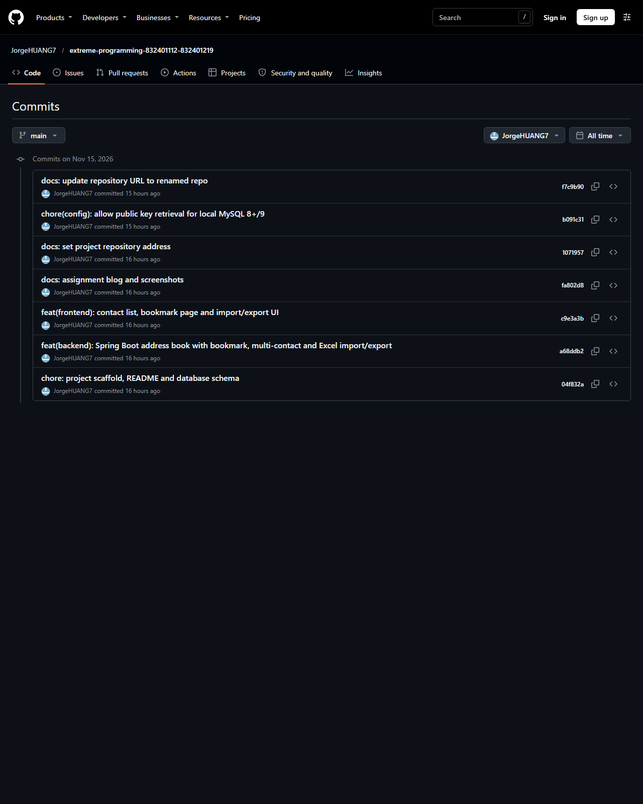

王少杰（`060725`）在 PR #1 中的 4 个功能与构建提交；此外还有 6 个文档提交，用于补充演示截图、博客插图、视频链接和作业链接：

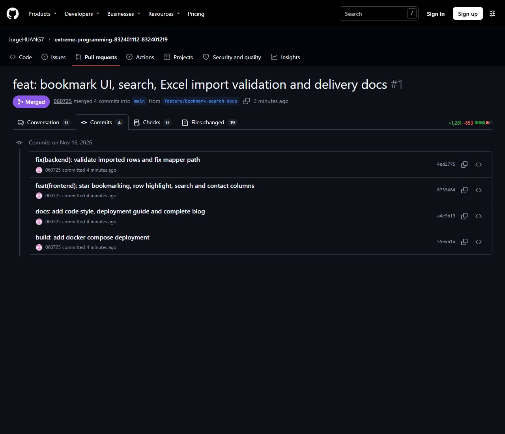

## 3. 模块划分与系统架构

编码之前，我们将系统拆分为四个模块，使两名成员能够并行开发、互不阻塞：

| 模块 | 职责 | 主要文件 |
| --- | --- | --- |
| 前端 | 页面、交互、请求封装、Excel 上传与下载 | `frontend/*.html`、`frontend/js/*`、`frontend/css/*` |
| 后端 | REST 接口、参数校验、收藏逻辑、Excel 解析与导出 | `backend/src/main/java/.../controller`、`service`、`utils` |
| 数据库 | 建表、默认值、示例数据 | `database/schema.sql` |
| 交付 | Docker Compose、部署、文档与博客 | `docker-compose.yml`、`docs/*` |

系统架构如下：

```
浏览器 (HTML/CSS/JS) --HTTP/JSON--> Spring Boot (Controller/Service/Mapper)
                                             |
                                       MySQL 8 (user 表)
```

- 前端为纯静态文件，可直接打开，也可由 Nginx 托管。
- 后端提供 RESTful API，数据访问使用 MyBatis-Plus。
- 导入与导出共用同一个 `User` 实体及其注解，因此系统导出的文件可以**原样重新导入**，无需手动修改表头。

## 4. 功能实现思路

### 4.1 收藏联系人

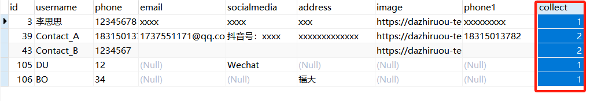

- **数据库：** 增加 `collect` 字段（`INT NOT NULL DEFAULT 1`），`1` 表示未收藏，`2` 表示已收藏。
- **后端：** `PUT /toggleBookmark` 切换收藏状态；`GET /collectList` 仅返回已收藏的联系人。
- **前端：**
  - 每一行提供 ★ / ☆ 按钮，点击即切换收藏状态并刷新列表；
  - 已收藏的行以黄色高亮（`tr.collected`），一目了然；
  - `collect.html` 只展示已收藏的联系人，并支持在收藏集合内搜索。


### 4.2 多联系方式


- **数据库：** 在原有 `username`、`phone` 基础上扩展 `phone1`（家庭电话）、`email`、`socialmedia`、`address`、`image`（头像 URL）。
- **前端：** 新增 / 编辑弹窗中为每种联系方式提供独立输入框，并提供头像选择与即时预览。
- **后端：** `/list` 返回全部字段；`POST /uploadImage` 将头像上传至阿里云 OSS 并返回 URL（可选功能）。
- **列表展示：** 表格直接显示姓名、手机号码、邮箱与地址，无需打开弹窗即可浏览主要联系方式。

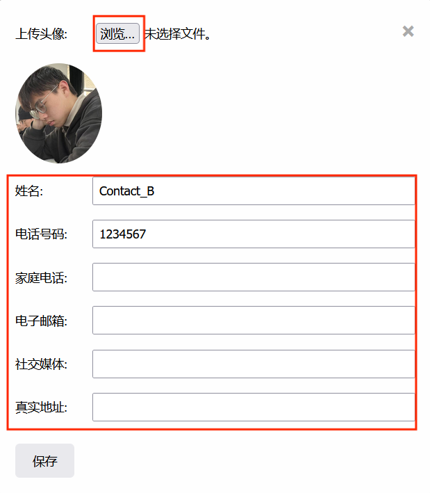

### 4.3 搜索与页面样式

- 工具栏提供搜索框，输入经 300ms 防抖后调用 `GET /list?name=...`，由服务端完成模糊过滤，数据量大时依然正确。
- 收藏页在已加载的收藏集合内本地过滤，切换更快。
- 页面采用卡片式容器、统一工具栏与 hover 反馈，并通过 `@media (max-width: 640px)` 适配窄屏。

### 4.4 导入与导出

**导出**


- 前端调用 `GET /export`，接收二进制流后触发下载，文件名为 `my_contacts.xlsx`。
- 后端使用 `ExcelExportUtil`（EasyExcel）写出：**每个联系人一行、每个字段一列**：
  `用户名 | 手机号码 | 家庭电话 | 邮箱地址 | 社交媒体 | 真实地址`。

**导入**


- 前端打开文件选择框，以 `multipart/form-data` 提交到 `POST /importExcel`。
- 后端使用 EasyExcel + `UserListener` 读取数据，并按每 100 条批量入库。
- 校验规则：
  - `用户名` 或 `手机号码` 为空的行会被**跳过**，而不是导致整批导入失败；
  - 导入的联系人 `collect` 默认为 `1`；
  - 接口返回 `ok:<成功数>:<跳过数>`，前端提示“导入完成：成功 N 条，跳过 M 条”；
  - 解析错误返回 `error:<原因>`，前端展示可读的错误信息。
- 由于导入导出共用同一实体的注解，系统导出的文件可直接重新导入。

### 4.5 部署

- `docker-compose.yml` 一次启动三个容器：MySQL 8、Spring Boot 后端、托管 `frontend/` 的 Nginx。
- `backend/Dockerfile` 使用 JDK 11 构建与运行（Spring Boot 2.3.x 不支持在 JDK 17+ 上编译）。
- `frontend/js/config.js` 会根据 `location.hostname` 自动推导 `API_BASE`：本地开发使用 `localhost:8888`，部署后自动指向 `http://<当前主机>:8888`，因此同一份构建可同时用于本地与云端。
- 部署步骤（安全组、Docker 安装、启动、验证与更新）见 `docs/deploy.md`。

## 5. 程序截图与运行视频

### 5.1 收藏联系人

联系人列表（收藏行黄色高亮，★ 表示已收藏）：

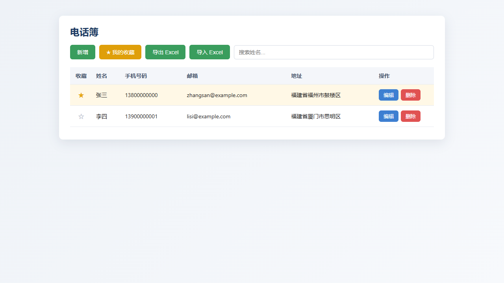

收藏状态切换：

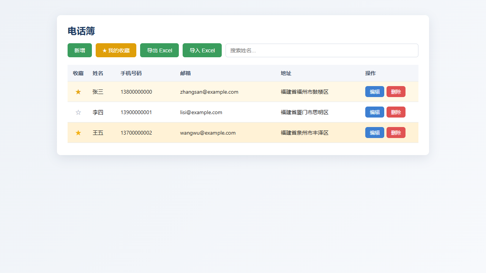

“我的收藏”页面：

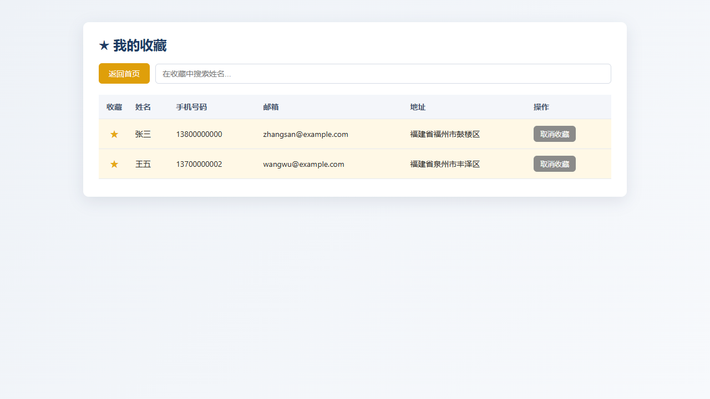

### 5.2 多联系方式

新增联系人时可填写手机号码、家庭电话、电子邮箱、社交媒体与真实地址：

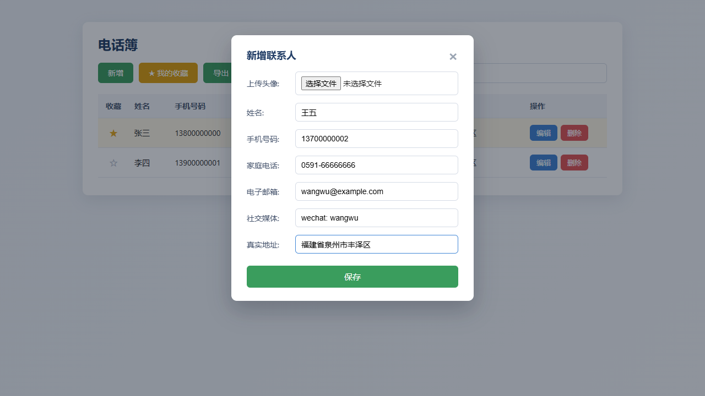

按姓名实时搜索：

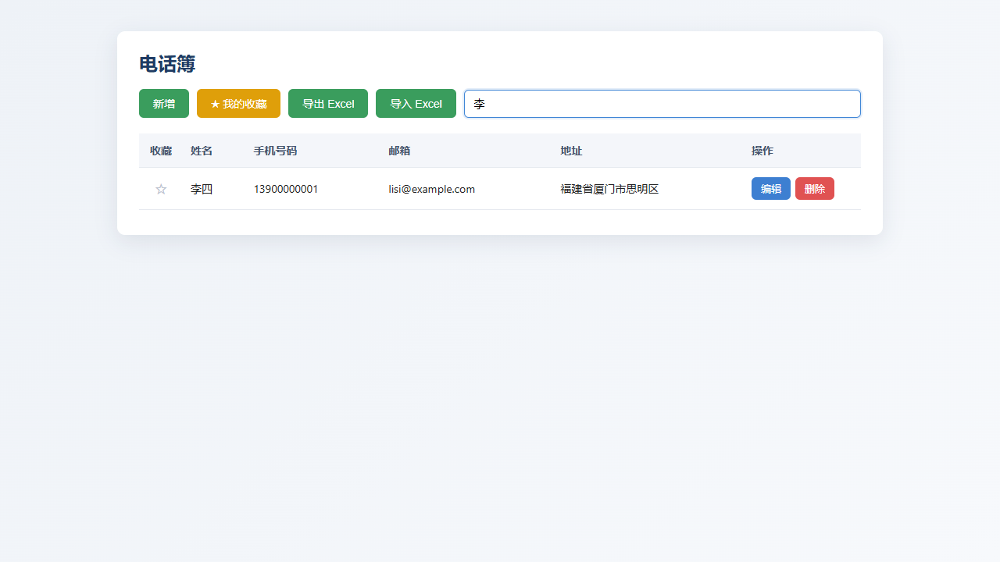

### 5.3 Excel 导出与导入

导出成功后下载的 `my_contacts.xlsx`（每个联系人一行、每个字段一列）：

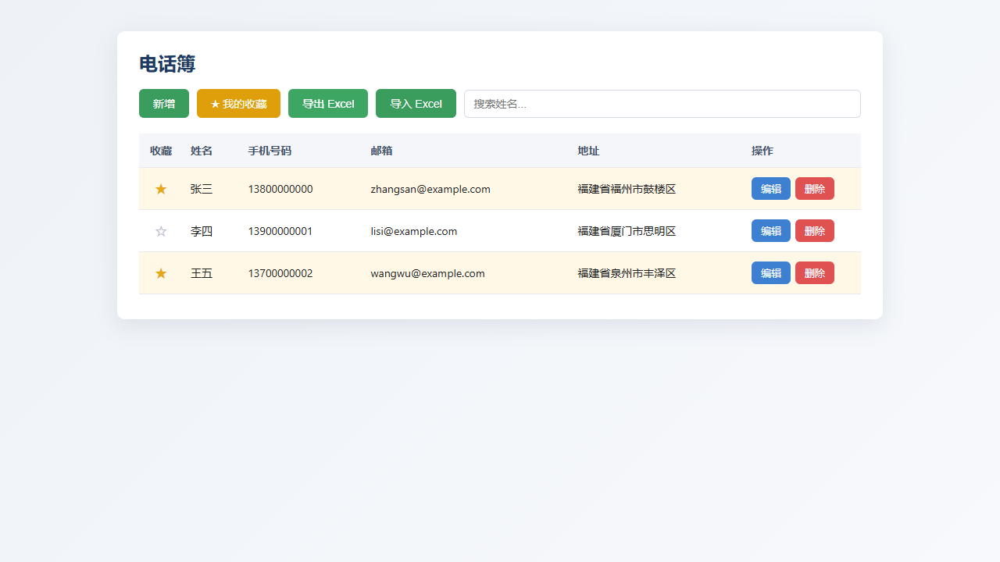

将同一文件重新导入，前端提示成功条数：

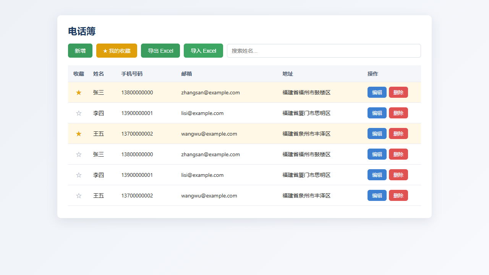

### 5.4 完整运行视频

演示视频（26 秒，1280×720，H.264）：<https://github.com/JorgeHUANG7/extreme-programming-832401112-832401219/releases/download/v1.0.0/demo.mp4>

下载页：<https://github.com/JorgeHUANG7/extreme-programming-832401112-832401219/releases/tag/v1.0.0>

视频依次演示：打开联系人列表 → 新增联系人（填写 5 种联系方式）→ 点击 ☆ 收藏（变为 ★ 且整行高亮）→ 按姓名搜索 → 进入“我的收藏”页 → 导出 Excel → 重新导入并提示“成功 3 条，跳过 0 条”。

## 6. 团队成员分工

| Name | Student ID | Work |
| --- | --- | --- |
| 黄致远 | 832401112 | 后端架构、数据库设计、Excel 导出、Docker 部署、博客审阅 |
| 王少杰 | 832401219 | 前端页面与交互、收藏界面、搜索、Excel 导入校验、代码规范文档、博客撰写 |

## 7. 成员贡献比例

| Name | Contribution |
| --- | --- |
| 黄致远 | 50% |
| 王少杰 | 50% |

## 8. 协作中遇到的困难与解决

### 8.1 黄致远

- **问题：** Excel 导入最初整批一次性入库，只要有一行缺少姓名或手机号，整次导入就会失败，且错误信息不可读。
- **解决：** 在 `UserListener` 中增加按行校验，改为每 100 条批量写入，并返回 `ok:<成功数>:<跳过数>` / `error:<原因>`，前端得以展示有意义的导入结果。
- **问题：** MyBatis-Plus 的 mapper XML 路径指向了不存在的包（`com.example.form`），会导致 mapper XML 被静默忽略。
- **解决：** 将 `mapper-locations` 修正为 `classpath*:com/example/files/**/*Mapper.xml`。
- **问题：** 在 Windows 下导入 `schema.sql` 后，数据库中的中文变成 `????`，原因是 MySQL 客户端使用了系统代码页而非 `utf8mb4`。
- **解决：** 使用 `mysql --default-character-set=utf8mb4 -u root -p < database/schema.sql` 导入，并确认返回的 JSON 字节为合法的 UTF-8。

### 8.2 王少杰

- **问题：** 最初的收藏交互只改变按钮文字，已收藏的联系人不明显。
- **解决：** 改用 ★ / ☆ 图标，增加 `collected` 行高亮以及独立的收藏页面。
- **问题：** 页面部署到云服务器后，`API_BASE` 仍指向 `localhost`，导致所有请求失败。
- **解决：** `config.js` 改为根据 `location.hostname` 推导 `API_BASE`，仅在本地开发时回退到 `localhost:8888`。

## 9. PSP 表

### 9.1 黄致远的 PSP 表

| Modules | Task Description | Estimated time (h) | Actual time (h) |
| --- | --- | --- | --- |
| Requirement analysis | 拆分模块并定义 REST 接口 | 3 | 4 |
| Preparation | 学习 EasyExcel 与 MyBatis-Plus | 4 | 5 |
| Back-end development | CRUD、收藏、导入导出 | 16 | 18 |
| Database development | 建表、默认值与示例数据 | 4 | 4 |
| Deployment | Docker Compose 与云服务器 | 5 | 6 |
| Testing and debugging | 接口测试与缺陷修复 | 7 | 8 |
| **Total** | | **39** | **45** |

### 9.2 王少杰的 PSP 表

| Modules | Task Description | Estimated time (h) | Actual time (h) |
| --- | --- | --- | --- |
| Requirement analysis | UI 流程与交互设计 | 3 | 3 |
| Preparation | 学习 Fetch API 与页面布局 | 4 | 4 |
| Front-end development | 列表、弹窗、收藏、搜索 | 16 | 18 |
| Integration | 联调前端与 REST 接口 | 5 | 6 |
| Documentation | 代码规范与博客 | 4 | 5 |
| Testing and debugging | 浏览器兼容与边界情况 | 6 | 7 |
| **Total** | | **38** | **43** |

## 10. 小结

本次作业完整走通了极限编程的协作流程：先划分模块、约定代码规范与提交信息，再通过
Fork + 分支 + Pull Request 并行开发，最终以 `v1.0.0` Release 交付。项目实现了收藏联系人、
多联系方式与 Excel 导入导出三项核心功能，并额外补充了搜索、收藏高亮与响应式样式。
在协作过程中，我们体会到**接口先行、职责清晰**对并行开发的重要性，也通过解决编码、
mapper 路径与跨域等问题加深了对前后端分离应用的理解。
